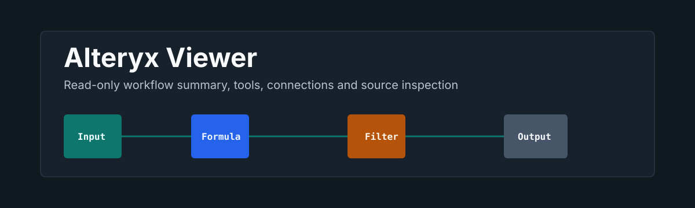
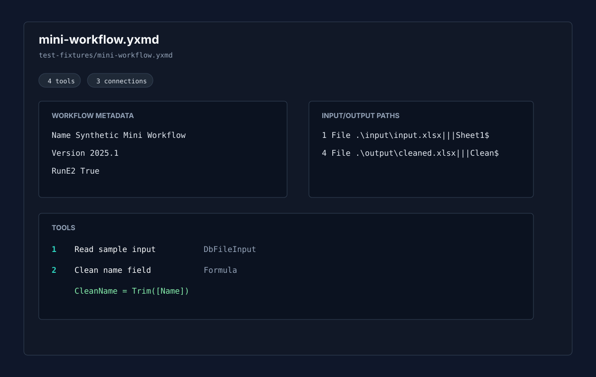

<p align="center">
  
</p>

<p align="center">
  <a href="https://github.com/viggomeesters/obsidian-alteryx-viewer/releases/latest"></a>
  <a href="LICENSE"></a>
  
  
</p>

# Alteryx Viewer

Alteryx Viewer is a read-only plugin for inspecting `.yxmd` workflows and listing `.yxzp` packages inside the vault. It summarizes workflow metadata, tools, tool types, connections, input/output paths, formula expressions, warnings, and source XML without executing, generating, converting, validating, or saving Alteryx files.



## Features

- Opens `.yxmd` workflow files in a dedicated view.
- Lists `.yxzp` package entries and highlights contained `.yxmd` workflows.
- Shows workflow metadata such as `yxmdVer`, workflow id, name, and run settings when present.
- Shows each tool with ToolID, inferred tool type, GUI plugin, engine entry point, annotation/label, container id, position, config summary, paths, and formulas.
- Shows connections as `origin tool.port -> destination tool.port`.
- Reports warnings for malformed XML, missing or duplicate ToolIDs, unknown synthetic/custom tool types, broken connections, and package contents.
- Keeps a source view with line numbers and lightweight XML highlighting available for workflow files.
- Filters tools, connections, package entries, paths, formulas, and config summaries.

## Inspect-only scope

This plugin never runs Alteryx workflows. It does not open Alteryx Designer, does not invoke shell commands, does not call external apps, and does not use network APIs, clipboard APIs, `eval`, dynamic function construction, or process execution APIs.

Version 0.1 intentionally does not generate, convert, validate, edit, normalize, or save `.yxmd` files. The local `alteryx-flow-agent-toolkit` remains the reference toolchain for generation, reverse engineering, conversion, comparison, and structural validation work. Alteryx Viewer only reads bytes through the vault API and renders local inspection views.

## Fixtures

Committed fixtures are synthetic only:

- `test-fixtures/mini-workflow.yxmd`
- `test-fixtures/containers.yxmd`
- `test-fixtures/broken-unknown.yxmd`
- `test-fixtures/package-listing.yxzp`

Do not commit real client workflows or private package fixtures.

## Installation

### Manual installation

Until a public release is available:

1. Download `main.js`, `manifest.json`, and `styles.css` from the latest release.
2. Create this folder in your vault: `.obsidian/plugins/alteryx-viewer/`.
3. Put the downloaded files in that folder.
4. Reload the app.
5. Enable **Alteryx Viewer** in **Settings -> Community plugins**.

### BRAT installation

For beta testing, install the plugin with [BRAT](https://github.com/TfTHacker/obsidian42-brat) using this repository URL:

```text
https://github.com/viggomeesters/obsidian-alteryx-viewer
```

## Usage

Open any `.yxmd` or `.yxzp` file in your vault. The file opens with Alteryx Viewer.

Use the toolbar to:

- filter visible details
- switch between summary, tools, connections, and source views for `.yxmd`
- refresh the current file after external changes

Malformed workflow XML automatically shows parse warnings and keeps source inspection available when possible.

## Development

```bash
npm install
npm run build
npx tsc --noEmit
npm test
```

Optional fixture comparison with the separate Alteryx toolkit:

```bash
cd /Users/viggomeesters/Dev/alteryx-flow-agent-toolkit
python tools/validate_yxmd.py /Users/viggomeesters/Dev/obsidian-alteryx-viewer/test-fixtures/mini-workflow.yxmd
python tools/yxmd_to_spec.py /Users/viggomeesters/Dev/obsidian-alteryx-viewer/test-fixtures/mini-workflow.yxmd --out /tmp/alteryx-viewer-mini-spec.md
```

## Release process

Community plugin files are installed from GitHub releases. For each release:

1. Update `manifest.json`, `package.json`, and `versions.json`.
2. Run `npm install`, `npm run build`, `npx tsc --noEmit`, and `npm test`.
3. Create a GitHub release whose tag exactly matches `manifest.json.version`.
4. Attach `main.js`, `manifest.json`, and `styles.css` as release assets.

## License

[MIT](LICENSE)
